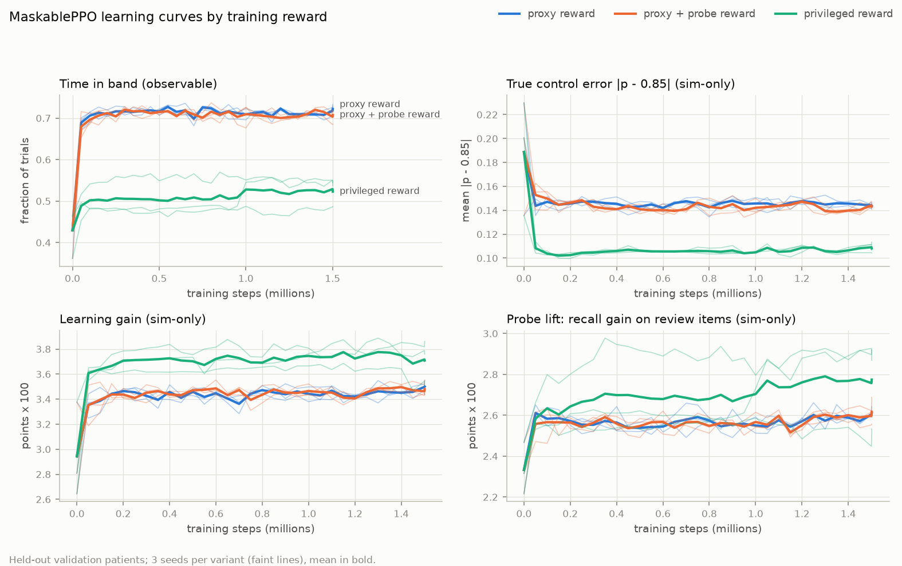
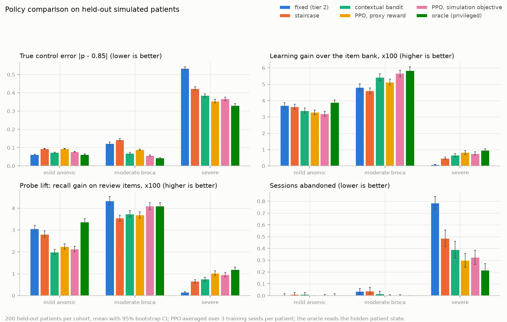
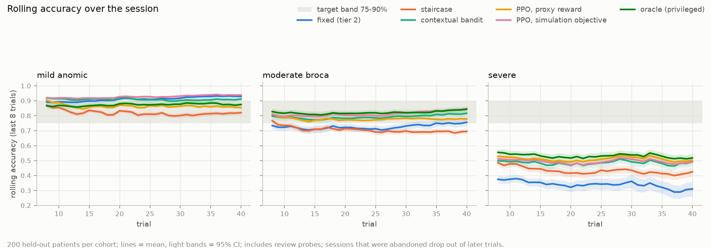
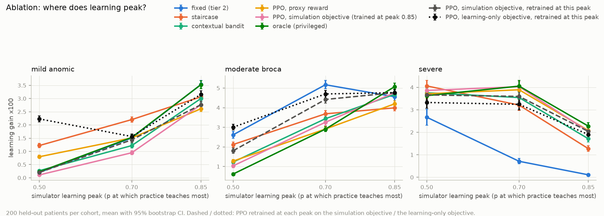

# CueAgain (Aphasia Trainer)

Picture-naming practice with speech input and a decision model adapted from human demonstrations.
The patient sees a picture and names it aloud. A pretrained speech recogniser proposes a transcript,
a helper confirms or corrects the result, and a decision model chooses what happens next: retry the
same picture with a predefined hint, or move on to a new picture at a chosen difficulty. A
clinician-facing view captures preferred decisions and shows how a model adapted with
**DITTO** (Shaikh et al., ICLR 2025) behaves.

**Proof-of-concept question:** can model adaptation make exercise-selection decisions follow a
demonstrator's preferences in situations it has not seen?

> **Prototype, not a clinical tool.** We make no claims of clinical effectiveness, faster recovery,
> diagnosis, or reliable assessment of impaired speech. The demonstrations are **fictional mock
> preferences** (team-authored, AI-drafted from a written strategy, pending human review), not
> clinician-validated treatment knowledge. A teammate's live speech shows usability, not performance
> on aphasic speech. No real patient data is used anywhere.

Speech recognition and DITTO are separate components: the recogniser (pretrained Whisper, not
trained here) turns audio into a *proposed* transcript; DITTO adapts a small language model
(Qwen3-1.7B + LoRA) that chooses the next action from recent confirmed attempts and the valid options.

## CueAgain status (2026-11-07)

Done and checked on this branch:

| piece | what exists | checked by |
|---|---|---|
| Patient practice screen | large picture, one main action, user-initiated microphone, explicit recording state, stop, hint, next picture, pause, no timer shown | used in the browser (typed answers; microphone path needs a person) |
| Speech | local `faster-whisper` `base.en` on CPU, no API key; WebM/Opus and MP4 browser recordings decoded with PyAV; silent, undecodable, timed-out or failed audio returns an explicit status and is never scored | synthesized speech in WebM/Opus transcribed as "Umbrella." (260 ms); tests for garbage and silence |
| Helper confirmation | transcript shown and editable, *suggested* match only, correct / sound / meaning / no response / **incorrect, type unclear**, or **not scored** (recording problem) | API tests |
| Attempt state | `session_id`, `exercise_id`, `presentation_id`, `attempt_id`; raw vs corrected transcript, scoring status, hint actually shown; idempotent by `attempt_id` (repeat = same result, different content = 409); stale picture = 409 | API tests |
| Retry vs next | explicit `retry_current` / `next_exercise`; the next picture is resolved deterministically from the manifest, never by the model | API tests |
| Picture bank | 24 items (`data/items.json`), predefined hints for each, Twemoji images (CC BY 4.0, `data/ATTRIBUTION.md`) | tests |
| Decision models | bandit baseline (existing Beta bandit, mapped to options), unadapted Qwen3-1.7B, few-shot prompted Qwen3-1.7B, SFT-only adapter, DITTO adapter; all validated against the valid options; invalid, unparseable or timed-out output falls back to the bandit **and says so** | API tests with scripted model outputs; real adapter in the browser and through `/act` |
| DITTO training | reproducible CLI, SFT + 3 DITTO rounds with expert / replay / intermodel comparisons, per-round adapters, manifest with base revision, template settings, demonstration IDs and hash, config, seed, metrics, status | one completed run (`demoA-qwen3-1.7b-r1`, 323 s on an Apple M4 Pro GPU via MPS, 4.1 GB peak); adapter reloaded in a fresh process |
| Evaluation | same reserved situations for every model, counts with denominators | `results/ditto_llm_test.md`, `results/ditto_llm_dev.md` |
| Clinician view | latest decision with its source, fallback reason and raw model output; alternatives in plain words; note; scope (session / patient / all); "Use my choice" replaces a not-yet-answered picture; "Save the proposal as a good example"; saved examples shown as **pending** until a training run lists them | used in the browser; API tests |
| Models & results view | activate a completed version for new sessions or the current session; training run details (demonstrations used, pairs per round, losses); measured comparison with per-situation successes and failures | used in the browser |
| Tests | 190 collected: 189 pass, 1 skipped (pre-existing PPO skip) | `uv run --extra llm --extra speech pytest` |

Compute: the brief planned a GCP L4 VM. `gcloud` is not installed or configured on the build
machine, and the local Apple GPU ran the whole pipeline (training 323 s, inference ~0.4 s per
decision), so **no cloud was used and $0 was spent**. The base model and LoRA setup are as planned;
only the device changed. On a CUDA machine the same commands pick `cuda` automatically.

### Results: does the adapted model follow the demonstrator on new situations?

Run `demoA-qwen3-1.7b-r1`, trained on the 20 training demonstrations. Settings were fixed before
any evaluation and not tuned afterwards. "Agrees" = the final action is one the demonstrator
accepts. On the test split every language-model answer was a valid option, so no result depends on
a fallback, except intermediate round 1 (4/10 unparseable answers, replaced by the bandit and counted).

| model | test (10 situations) | dev (5 situations) | valid output (test) | median latency |
|---|---|---|---|---|
| Qwen3-1.7B, task instruction only | 2/10 | 1/5 | 10/10 | 0.34 s |
| same + 20 training demonstrations in the prompt | 5/10 | 2/5 | 10/10 | 2.7 s |
| SFT adapter only | 3/10 | 1/5 | 10/10 | 0.38 s |
| DITTO after round 1 / round 2 | 3/10 / 4/10 | 1/5 / 0/5 | 6/10 / 10/10 | 0.36 s |
| **DITTO, final (round 3)** | **6/10** | **1/5** | 10/10 | 0.38 s |
| bandit baseline | 4/10 | 1/5 | n/a | <1 ms |

What this does and does not show (per-situation tables in `results/ditto_llm_test.md`):
- On the test split the DITTO adapter agreed with the demonstrator more often (6/10) than the
  unadapted model (2/10), the SFT-only adapter (3/10) and the bandit (4/10), and slightly more than
  few-shot prompting (5/10) at about a seventh of its latency. Successive rounds moved 3 → 4 → 6.
- **It is not robust.** On the 5 development situations every model scores 0 to 2. With 10 and 5
  situations, one or two decisions change the ranking; this is an exploratory check, not evidence.
- **The adapter learned "move on" better than "retry with the matched hint".** It got all
  move-on situations right on test (tier up after a fast answer, same tier after a hint, easier
  late in the session) except one, and missed every retry-with-hint situation (sound error → first
  sound; unclear error → sentence; after the first sound → sentence or description). The same
  happened live: after a confirmed meaning error it moved on instead of giving a description.
- The preferences come from a written rule (`data/demonstrations/README.md`), so a hand-coded rule
  would score 10/10. The question is whether a language model picks the preference up from 20
  demonstrations, not whether a language model is needed for this rule.
- Training statistics are in the run manifest: after SFT, 46 of 120 sampled decisions already
  matched the demonstrator (60/120 by round 3); 42 expert, 12 replay and 6 intermodel comparisons
  were used per round (available after filtering: 74 expert in round 1; 60 expert, 150 replay and
  1,061 intermodel in round 3).

### Not done / limitations

- Live speech has only been exercised with synthesized speech and typed answers on the build
  machine; a person must try the microphone path in a browser (Chrome or Safari) before the demo.
  Whisper `base.en` is not evaluated on aphasic speech, and the helper always confirms.
- Training was not triggered from the browser (optional in the brief); it is a CLI. Clinician
  examples saved in the app are not in the trained checkpoint; they can be added to a future run
  with `--extra-demos runs/demonstrations/captured.jsonl` (global-scope examples only).
- The demonstrations are pending human review by a teammate.
- MultiPic could not be downloaded non-interactively; Twemoji pictures are used instead (see
  `data/ATTRIBUTION.md` for how to switch). Tiers are prototype settings.
- One service worker; sessions are in memory with JSON snapshots in `runs/practice/` (restored at
  startup). Multiple workers would need a shared store, and each would load its own model.
- No recorded backup demo has been made yet.

## Run CueAgain

```bash
uv sync                                                         # CPU baseline: bandit decisions, typed answers
uv run uvicorn service.app:app --port 8000                      # open http://localhost:8000/app/
```
```bash
uv sync --extra speech                                          # + local speech recognition (no key; ~150 MB model on first use)
uv sync --extra llm --extra speech                              # + language-model decisions and training
uv run --extra llm --extra speech uvicorn service.app:app --port 8000
```
`uv sync` without the extras removes them from the environment, so keep passing the extras you use.
The default decision model for new sessions is `default_model` in `configs/practice.yaml`
(`bandit`); switch versions in **Models & results**. Base model and pinned revision:
`llm.base_model` / `llm.revision` in the same file.

Reproduce the experiment (Apple MPS or CUDA; about 6 minutes on an M4 Pro):
```bash
uv run --extra llm python -m training.smoke --model Qwen/Qwen3-0.6B            # train/save/reload smoke test
uv run python -m training.build_demonstrations                                    # rebuild the dataset (deterministic)
uv run --extra llm python -m training.ditto --run-id demoA-qwen3-1.7b-r1          # SFT + 3 DITTO rounds -> runs/ditto/<run_id>/
uv run --extra llm python -m evaluation.compare --run demoA-qwen3-1.7b-r1 --split test --rounds --markdown results/ditto_llm_test.md
uv run --extra llm python -m evaluation.compare --run demoA-qwen3-1.7b-r1 --split dev --rounds --markdown results/ditto_llm_dev.md
uv run --extra llm python -m training.ditto --extra-demos runs/demonstrations/captured.jsonl   # include saved clinician examples
```
Serve an adapter behind the original `/act` contract: set `agent: llm` and
`llm_model: "ditto:<run_id>"` in `configs/service.yaml`. `/act` then answers from the adapter when the
State carries `current_exercise`. The response body stays `{tier, cue, rationale}`; the
`X-Decision-Source`, `X-Requested-Model` and `X-Fallback-Reason` headers say which model answered.

Runs, adapters, evaluations, sessions and captured examples live in `runs/` (gitignored). The
adapter of the run above is 25 MB (`runs/ditto/demoA-qwen3-1.7b-r1/round3`); copy that folder to
share it. No secrets are needed or committed.

## CueAgain API (added; existing endpoints unchanged)

| method | path | purpose |
|---|---|---|
| GET | `/items` | picture manifest with hints |
| POST | `/transcribe` | multipart `audio` (+ `exercise_id`): `{status: ok/empty/failed/timeout/unavailable, text, provider, error, suggestion}` |
| GET | `/speech/status` | which speech provider is configured |
| POST | `/practice/sessions` | start a session (`model_version` optional) → first presentation |
| GET | `/practice/sessions`, `/practice/sessions/{id}` | session list; full history, decisions, stats (named without a hint vs after a hint) |
| POST | `/practice/sessions/{id}/attempts` | one attempt: `attempt_id`, `presentation_id`, raw and corrected transcript, `scoring_status` (`confirmed` / `unscored`), `correct`, `error_category` (`sound` / `meaning` / `no_response` / `unclassified`), `response_time_s` → decision + next presentation |
| POST | `/practice/sessions/{id}/manual` | patient/helper "show a hint" or "next picture" (logged as manual) |
| POST | `/practice/sessions/{id}/override` | clinician replaces a not-yet-answered decision (+ saves the example) |
| POST | `/practice/sessions/{id}/model`, `/pause` | switch this session's model; pause/resume |
| POST/GET | `/demonstrations` | save a preferred or accepted decision (with scope); list with training status |
| GET/POST | `/models`, `/models/active` | versions and availability; activate for new sessions |
| GET | `/runs`, `/runs/{run_id}` | training manifests and their evaluations |

Changes to the existing contract (additive): `ErrorType` gains `unclassified` (a confirmed error of
unknown kind; it has no one-hot slot in trained PPO observations); `TrialRecord` gains optional
`exercise_id` / `attempt_id`; `State` gains optional `current_exercise`; `/update` accepts an optional
`attempt_id` and is then idempotent (duplicate → `{"status": "duplicate"}`, conflicting content → 409).
The `Action` body is unchanged.

## How the decision model is trained (DITTO)

All code paths render contexts and parse actions through one module (`core/practice.py`), so
training, evaluation and serving see identical text. The model receives the current picture and its
tier, the hints already shown and attempts on it, the latest attempt, up to 4 earlier attempts, the
session time, and the list of valid options, and must answer with one option, e.g.
`{"op":"retry","hint":"first_sound"}` or `{"op":"next","tier":2}`. Qwen3 thinking is disabled
consistently (`enable_thinking=False`).

`training/ditto.py` follows the authors' implementation (`SALT-NLP/demonstrated-feedback`):
1. **SFT**: LoRA adapter `sft` (r 16, q/k/v/o) on the demonstrations' answer tokens, with an early
   stop on the loss (stopped at 6 steps, loss 0.14).
2. **DITTO**: adapter `ditto` initialised as a copy of `sft`; the fixed `sft` adapter is the DPO
   reference policy (as `ref_adapter_name="sft"` in the reference).
3. Each round: sample 6 answers per training context from the current `ditto` policy (temperature 1)
   into a cache keyed by round; build comparisons **expert** (demonstration ≻ this round's sample),
   **replay** (demonstration ≻ earlier rounds' samples) and **intermodel** (later round's sample ≻
   earlier round's sample); draw 70% / 20% / 10% of n_prompts × 3 pairs (reference defaults); run 15
   DPO steps (β 0.1, lr 5e-5); save the round's adapter. 3 rounds.

Differences from the reference, and why:
- Pairs are drawn once per round, not per batch inside the data collator; rounds play the role of
  the reference's `resample_rate` steps.
- With structured answers, exact repeats are common. Pairs whose two sides are the same action
  (even if worded differently), and pairs whose rejected side is an action the demonstrator also
  accepts, are discarded rather than trained on. Generated comparisons add training material, not
  independent expert judgments; the manifest records how many samples already matched the
  demonstrator, so we never invent rejected examples to reach a pair count.
- Intermodel pairs rest on DITTO's assumption that each round's policy is closer to the demonstrator
  than earlier ones. Round 2 made more unparseable answers than round 1, so on this run the
  assumption did not hold strictly. We kept the reference construction and report it.
- The DPO loss (sigmoid, as in TRL's `DPOTrainer`) is implemented directly, with reference
  log-probabilities computed once per round, instead of through TRL. This keeps the fixed SFT
  reference adapter and the per-round pairs explicit; TRL is therefore not a dependency.
- Learning rate and β are larger than the reference's (1e-6, 0.05) because the answers are about
  10 tokens and each round has only 15 steps; chosen before any evaluation, not tuned.

A preference never changes a hard constraint: at most 3 attempts per picture, tier moves of at most
one step, approved hints only (`configs/clinical.yaml`, `configs/practice.yaml`). These are enforced
on every model's output at the service boundary. The 85% target in `configs/clinical.yaml` belongs
to the bandit/PPO research below; it is not the DITTO objective.

---

The sections below describe the team's earlier RL research on simulated patients (PPO, bandits,
DITTO-style tuning of the PPO policy). It is kept as is; the CueAgain flow above reuses its schema,
masks, service and Beta bandit.

## Aphasia Trainer: RL therapist research

A home practice trainer for people with aphasia, the loss of language that follows many strokes. The
patient names pictures; an AI therapist chooses the difficulty and the hint (cue) for every trial so
the patient stays near 80 to 85 percent correct. The therapist is trained against a population of
simulated patients and runs live on a real person, and a speech-language pathologist (SLP) can
override any of its choices.

> **Practice tool used under an SLP.** It does not diagnose, replace therapy, or make treatment
> decisions. No real patient data is used anywhere. We do not claim it improves recovery in real
> patients.

## The system

| component | what it does |
|---|---|
| Patient app | Browser app: shows a picture, takes a spoken or tapped answer, shows the cue. Large type, one thing on screen. |
| Speech scorer | Transcribes the answer and labels it: correct, sound error, meaning error, or no response. |
| Therapist agent | Chooses the next difficulty tier and cue from the session so far (`agents/`, served by `service/`). |
| Patient simulator | A population of simulated patients used to train and evaluate the therapist (`sim/`). |
| Clinician dashboard | Session trace (difficulty, accuracy, error types, the agent's choices) with an override on every choice. |
| Expert-feedback loop | Clinician overrides are stored as demonstrations so the therapist can learn a clinician's preferences. |

Live loop: the patient names a picture, the scorer labels the answer, the therapist picks the next
picture's tier and cue, and the app shows it. Two learning signals feed the therapist: practice on
simulated patients, and demonstrations from clinician overrides.

## Status

The team objective is **better later naming without hints**. Sessions therefore include review
probes (an earlier practised word shown again with no cue), and every policy is evaluated on them.

Implemented and tested (149 tests, `uv run pytest`):
- Agent service (FastAPI) implementing the agreed State/Action interface, with one online-learning
  agent per session, clinician overrides logged for later training, CORS for a frontend on the local
  network, and `POST /next_trial`, which applies the shared item-selection and review-probe rule.
- Patient simulator: population sampling with a held-out test split, three evaluation cohorts,
  item difficulty from word frequency and length, patient-specific cue responsiveness, error types,
  fatigue with recovery, learning with a configurable peak, patient dropout after failure streaks,
  and review probes. The item bank is a placeholder.
- Therapist agents: MaskablePPO trained on the observable proxy reward (the live demo agent, chosen
  for visible adaptation to a healthy user), MaskablePPO trained on the simulation-only objective and
  the contextual Bayesian logistic Thompson-sampling bandit (live fallbacks), a Beta-Bernoulli
  Thompson bandit, and fixed-difficulty and staircase baselines.
- Trained agent: a Gymnasium environment with clinical action masks and a decomposed reward, and
  MaskablePPO trained on simulated patients with three rewards (observable proxy, proxy + review-probe
  bonus, privileged simulator-only objective), 3 seeds each, learning curves on held-out patients.
- Learning from clinician overrides: DITTO-style preference optimisation of the PPO policy from ~10
  overrides, with a before/after evaluation on held-out states.
- Evaluation harness: privileged oracle, 200 held-out patients per cohort, bootstrap CIs, paired
  differences and the two result figures, reproduced by one command (`eval/compare.py`); ablations of
  the learning-peak assumption, dropout and the reward (`eval/ablations.py`).

In progress or planned:
- Patient app, clinician view and speech transcription now exist for the CueAgain flow (above);
  automatic error classification from speech is deliberately not done (the helper confirms).
- The prompted frontier-model baseline is implemented and tested with a mocked API; it runs as soon as
  an API key is available (`configs/eval_llm.yaml`).
- A clinically curated item bank and clinical validation of the simulator's parameters.

Explored, not part of the current scope: a language-model therapist trained with GRPO on Tinker
(prompt format, offline reward and dataset, and a 10-step smoke test are in `agents/llm_prompt.py`
and `train/grpo_*.py`; never run against the API).

## Quick start

```bash
uv sync                                         # Python 3.11 env from uv.lock
uv run pytest                                   # test suite
uv run uvicorn service.app:app --host 0.0.0.0 --port 8000   # agent service, reachable on the LAN
uv run python -m scripts.service_smoke --url http://localhost:8000   # 40-trial session over HTTP
uv run python -m train.fit_bandit_prior         # refit the bandit's empirical-Bayes prior (~2 s)
uv run python -m train.train_ppo --reward full          # MaskablePPO, 3 seeds (~3 min each on CPU) -> models/
uv run python -m train.train_ppo --reward full_probe    # proxy + review-probe bonus
uv run python -m train.train_ppo --reward privileged    # simulator-only objective (reference)
uv run python -m eval.plots                     # learning curves -> results/learning_curves.png
uv run python -m train.ditto_ppo                # DITTO-style tuning from overrides -> results/ditto_report.md
uv run python -m scripts.validate_live_ditto     # live override learning on fresh states
uv run python -m scripts.judge_demo --url http://localhost:8000 --name live   # healthy-judge check
uv run python -m eval.compare --config configs/eval.yaml   # full evaluation -> results/
uv run python -m scripts.sanity_table --dropout on --out results/sanity_dropout_on.md
uv run python -m scripts.sanity_table --dropout off --out results/sanity_dropout_off.md
uv sync --extra grpo && uv run python -m train.grpo_smoke   # explored, out of scope; needs TINKER_API_KEY
```

**Frontend on another laptop:** run the service with `--host 0.0.0.0`, find this machine's LAN IP
(`ipconfig getifaddr en0` on macOS) and call `http://<that-ip>:8000`. CORS allows the Vite dev server
(port 5173) on localhost and on any private-network address (`cors_origins` / `cors_origin_regex` in
[`configs/service.yaml`](configs/service.yaml)). The macOS firewall may ask to allow incoming
connections for Python the first time.

## Repository layout

RL and agent code lives at the repository root; the frontend app goes in `frontend/`.

```
core/      shared schema (State/Action/Outcome), typed config loading, action masks
agents/    therapist policies behind one interface (agents/base.py)
service/   FastAPI agent service the frontend calls
sim/       simulated patient population
envs/      Gymnasium environment with action masks
train/     PPO training, bandit-prior fitting, language-model (GRPO) training
eval/      metrics and figures
models/    trained PPO policies (small, committed so results reproduce without retraining)
configs/   all tunable values (YAML)
scripts/   smoke tests and utilities
tests/     pytest suite
results/   committed CSV/PNG outputs for this README
docs/      starter scaffold kept for reference (docs/scaffold/rl_starter.py)
frontend/  patient app and clinician dashboard
```

## Branches

- `main`: stable and demo-ready only. Updated from `dev` at checkpoints, when the demo works end to end.
- `dev`: integration branch. Small fixes (CORS, typos, README) may be committed here directly.
- `feature/rl-agent`: all RL work (simulator, bandits, training, evaluation), branched from `dev`.

Merges happen only through pull requests on GitHub (`feature/rl-agent` → `dev`, and `dev` → `main`
at checkpoints), opened once the tests pass and a piece works. Nobody merges locally.

## Interfaces

The contract between the frontend, the scorer and the agent. Defined once in
[`core/schema.py`](core/schema.py) (pydantic); the service validates every request against it and
returns HTTP 422 with a precise error on any violation.

**Changes from the original contract (all additive and backward-compatible):**
1. `State` has an optional `session_id`. The service keeps one online-learning agent per session;
   requests without it share a single `default` session. **Please always send it** (one id per
   patient session, any string up to 128 chars).
2. `POST /update` takes an explicit `outcome` object (shape below).
3. Review probes: trials may carry `"probe": true`; `POST /update` accepts `"probe": true`; and
   `current_tier` means the tier of the last trial the **agent** chose (probes do not change it).
4. New endpoint `POST /next_trial` returns the complete next trial (word, image, tier, cue, probe)
   using the shared item-selection rule below, so the frontend does not have to implement it.
5. New endpoint `POST /learn_from_overrides` (live demo of learning from the clinician, below).

### State
```json
{"session_id": "patient-42-2026-11-07",
 "last_trials": [{"word": "cat", "tier": 2, "cue": "first_sound", "outcome": false,
                  "error_type": "sound", "response_time": 3.1}],
 "current_tier": 2, "trial_count": 14, "session_minutes": 6.5}
```
| field | type | rule |
|---|---|---|
| `session_id` | string, optional | 1 to 128 chars |
| `last_trials` | list | most recent last; up to 10 (longer lists are truncated to the last 10) |
| `last_trials[].tier` | int | 1..3 |
| `last_trials[].cue` | string | `none \| first_sound \| first_letter \| sentence_frame \| semantic` |
| `last_trials[].outcome` | bool | must be `true` iff `error_type == "correct"` |
| `last_trials[].error_type` | string | `correct \| sound \| meaning \| no_response` |
| `last_trials[].response_time` | float | seconds, >= 0 |
| `last_trials[].probe` | bool, optional | `true` for a review probe (default `false`) |
| `current_tier` | int | 1..3, the tier of the last trial the agent chose; review probes do not change it |
| `trial_count` | int | >= 0 |
| `session_minutes` | float | >= 0 |

Unknown extra fields are ignored, so adding e.g. a timestamp will not break anything.

### Action
```json
{"tier": 2, "cue": "first_sound", "rationale": "short text for the dashboard"}
```
`tier` in 1..3, `cue` as above. `rationale` is a human-readable explanation (may be null).
The agent never returns a tier more than one step from `current_tier`, and never a cue outside the
clinician-approved set in [`configs/clinical.yaml`](configs/clinical.yaml).

### Outcome
```json
{"correct": false, "error_type": "sound", "response_time": 3.1}
```
`correct` must be `true` iff `error_type == "correct"`.

### Item selection and review probes (the frontend must use the same rule)
The agent chooses only the tier and cue; the item is chosen by this rule (implemented in
[`sim/items.py`](sim/items.py) and used by the simulator and by `POST /next_trial`). Trials are
numbered k = 0, 1, 2, ... over the whole session, probes included.
1. **Review probe** if review probes are enabled, (k + 1) is a multiple of 5, and an eligible item
   exists. Eligible: practised earlier in this session as a normal trial, and not shown in the last
   3 trials. Pick the eligible item with the fewest probes so far this session; ties go to the item
   first practised earliest. Show it **with no cue**, at its own tier. Do not call `/act` for it.
2. **Otherwise a normal trial:** call `/act`, then pick an item in the returned tier that has not
   been shown this session; if all have been shown, the least recently shown (ties at random).
Parameters live in [`configs/sim.yaml`](configs/sim.yaml) (`review_probes`: `every` = 5,
`min_gap` = 3). The simplest integration is `POST /next_trial`, which applies this rule server-side.

### Endpoints
| method | path | body | returns |
|---|---|---|---|
| GET | `/health` | none | `{"status": "ok", "agent": "...", "active_sessions": n}` |
| POST | `/next_trial` | `State` | `{"word", "image_file", "tier", "cue", "probe", "rationale"}` |
| POST | `/act` | `State` | `Action` |
| POST | `/update` | `{"state": State, "action": Action, "outcome": Outcome, "probe": false}` | `{"status": "ok", "session_id": "...", "agent_updated": bool}` |
| POST | `/override` | `{"state": State, "agent_action": Action, "clinician_action": Action, "note": "optional"}` | `{"status": "stored", "session_id": "...", "n_overrides": n}` |
| POST | `/learn_from_overrides` | `{"session_id": "..."}` | `{"n_overrides", "n_skipped", "n_anchor_states", "seconds", "by_state_type": [{"state_type", "clinician_cue", "n_overrides", "n_eval_states", "p_before", "p_after"}], "other_states_unchanged"}` |

Session loop for the frontend:
1. `POST /next_trial` with the current `State` (or apply the rule above yourself and call `/act`
   for normal trials). Show the returned word with the returned cue.
2. If the clinician overrides a normal trial, `POST /override` with both actions and show the
   clinician's action.
3. After the patient answers, `POST /update` with the same `State`, the action **actually shown**
   (the clinician's if overridden), the `Outcome`, and `"probe"` as returned. Agents do not learn
   from probes, which they did not choose.
4. Append the trial (with `"probe"`) to `last_trials`; if it was not a probe, set `current_tier` to
   its tier. Repeat.

Overrides are stored as JSON lines in `runs/overrides.jsonl` (the input to `train/ditto_ppo.py --overrides`).

**Live learning from overrides (`POST /learn_from_overrides`, PPO agent only).** Runs one
DITTO-style round (see the DITTO section) on the overrides logged **in this session**, then swaps in
the tuned policy **for this session only** (other sessions and the base model are unchanged).
Anchors are this session's accepted choices plus the base policy's own decisions on 30 validation
patients, excluding the state types the clinician overrode. It takes well under a second on CPU
(~0.3 s for 10 overrides; the first call also collects the anchor pool, about 1 s). The response
reports, for each overridden state type (for example `"after a sound error"`), the mean probability
of choosing the clinician's cue in reference states of that type before and after, and the share of
other reference states whose top action is unchanged. Example on the live agent with 10 overrides
"after a sound error, use first_sound" collected from states the policy actually visits: `p_before`
0.35, `p_after` 0.91, `other_states_unchanged` 1.00 (0.5 s); the session then chose first_sound in
held-out sound-error states. Validation on fresh states: see the DITTO section. Errors: 409 if the live agent is not PPO, 400 if the session has no overrides.
Demo flow: play a few trials, override the cue a handful of times on the dashboard, call this
endpoint, and continue: the next similar states get the clinician's choice.
Interactive API docs: `http://localhost:8000/docs` while the service runs.

## Demo script

Start the service (`uv run uvicorn service.app:app --host 0.0.0.0 --port 8000`; `GET /health` should
report `"agent": "ppo"`). Use one `session_id` per demo, e.g. `"demo-judge"`. Each step below is one
or more API calls; the right column is what the clinician dashboard should show.

| step | API calls | dashboard shows |
|---|---|---|
| 1. Naming | `POST /next_trial` with the State (`trial_count` 0, `current_tier` 1, empty `last_trials`); the judge names the picture; `POST /update` with the outcome and `"probe": false`. Repeat. | The picture, the chosen tier and cue (`none`), the agent's `rationale`; the tier timeline and rolling accuracy with the 75-90% band. After 5-7 correct answers the tier climbs to 2, then 3. |
| 2. Cue after an error | The judge gives a wrong answer (or none) on purpose, 2-3 times in a row; keep calling `POST /next_trial` and `POST /update`. | The agent steps the tier down and offers a cue (e.g. first letter), with the rationale; error types appear in the breakdown. After the judge recovers, the tier climbs back. |
| 3. Review probe | Every 5th trial `POST /next_trial` returns `"probe": true` (a word practised earlier, `cue: "none"`); `POST /update` with `"probe": true`. | A "review, no hint" label on that trial; the current tier is unchanged; probe results are tallied as "recalled without a hint". |
| 4. Override | On a trial right after a sound error, the clinician presses override and picks the first-sound cue (same tier): `POST /override` with `state`, `agent_action`, `clinician_action`; show the clinician's cue; `POST /update` with the clinician's action. Repeat on a few such trials (10 give a strong effect; fewer give a smaller one). | The override is marked on the timeline; the override count increases. |
| 5. Learn from the clinician | `POST /learn_from_overrides` with `{"session_id": "demo-judge"}` (well under a second). | "After a sound error: P(first sound) 0.35 -> 0.9x; other behaviour unchanged ~98-100%" from the response (`by_state_type`, `other_states_unchanged`). |
| 6. The agent now makes the clinician's choice | Continue the session; after the next sound error `POST /next_trial` returns the first-sound cue without an override. | The cue matches the clinician's earlier choice; no override was needed. |

Fallback if the live agent misbehaves: set `ppo_model: models/ppo_privileged_seed0.zip` or
`agent: logistic_bandit` in `configs/service.yaml` and restart (`/learn_from_overrides` needs a PPO
agent).

## Problem formulation

A **POMDP**. The patient's true state (retrieval ability per item, fatigue, responsiveness to each
cue type, learning rate) is hidden; the agent only observes trial outcomes through the State JSON.
An **episode** is one session of 40 trials; a **step** is one trial. The **action** is (tier 1..3) x
(cue: 5 types) = 15 discrete actions. Clinical constraints are **action masks**, not penalties: tier
moves at most one step per trial, and cues outside the clinician-approved set are never offered.

## Simulated patients (`sim/`)

`p(correct) = sigmoid(ability + item_learning[i] - difficulty[i] + cue_gain[cue] - fatigue)`, all on
the log-odds scale. Every parameter is in [`configs/sim.yaml`](configs/sim.yaml) with a comment that
either cites the paper behind the *direction* of the effect or says `ASSUMPTION`.

| component | model | grounding |
|---|---|---|
| item difficulty | `beta_f * (-z(frequency)) + beta_l * z(length)` | frequency and length effects on naming (Nickels & Howard 1995) |
| cues | `phonemic_weight[cue] * phon_resp + semantic_weight[cue] * sem_resp`, per-patient responsiveness | phonemic > semantic on average, with phonemic vs semantic responders (Meteyard & Bose 2018) |
| error types | after a failure, P(sound, meaning, no response) proportional to (phon_impair, sem_impair, omission_bias) | simplified from the two-step model (Dell et al. 1997; Schwartz et al. 2006) |
| fatigue | grows per trial and faster during failure streaks, recovers a fraction each trial, capped | ASSUMPTION |
| learning | on a success, item-specific gain with E[gain] = p^a (1-p)^b, peaking at a configurable `peak`; weaker cues teach more; 5% spills over to general ability | item-specific gains with limited generalisation (Nickels 2002); the peak location is an ASSUMPTION; see the learning-peak ablation |
| response time | log-normal, slower for hard items and when fatigued | ASSUMPTION |
| dropout | after 3 failures in a row the patient may quit: 5% per trial, +5% per further failure | ASSUMPTION (conservative); results reported with dropout on and off |
| review probes | every 5th trial re-tests a practised word without a cue (rule in Interfaces); scored like any trial | measurement design, not a patient assumption |

**Population, not fixed profiles.** Training patients are drawn from broad parameter distributions
(domain randomisation). Three named presets (mild anomic, moderate Broca's, severe) are narrow
cohorts used only for evaluation. Patient *k* of a split comes from `SeedSequence([seed, split, cohort, k])`,
so the **train and test populations are disjoint** (tested), and every policy faces exactly the same
patients with the same random outcome stream (common random numbers, so comparisons are paired).

**Item bank.** Loaded from a CSV with columns `word,image_file,frequency,length,tier` (schema in
[`sim/items.py`](sim/items.py)). The committed bank [`data/items_placeholder.csv`](data/items_placeholder.csv)
is a **PLACEHOLDER**: 60 picturable nouns, frequencies from the `wordfreq` package (Zipf scale),
length in letters, tiers = difficulty terciles. It is to be replaced by a clinically curated bank. Within a tier,
items are shown unseen-first, then least recently seen; the app should use the same rule.

## Agents (`agents/`)

All agents implement one interface (`act(state, mask) -> Action`, `update(state, action, outcome)`)
and decide from the State JSON only.

- **Fixed difficulty** (worksheets today) and **2-up/1-down staircase** (Levitt 1971).
- **Beta-Bernoulli Thompson bandit**: 15 independent arms, ported from the scaffold and bug-fixed.
- **Contextual Bayesian logistic Thompson bandit** (live fallback; learns online per session): `p(correct) = sigmoid(w . phi)`
  with 17 features (tier, cue, recent accuracy, fail streak, progress, response time, and last error
  type x cue family; the simulator does not yet model that interaction, see below). Posterior updated online with the closed-form Laplace/extended-Kalman step,
  with random-walk process noise so it tracks fatigue and learning. Weights are shared across
  actions, so one observation informs many actions.
- **Empirical-Bayes prior** for the contextual bandit, fitted on 300 simulated *training* patients
  (`train/fit_bandit_prior.py`): the per-patient weights' mean and shrunk covariance. This is the
  bandit's sim-to-real pretraining. It is inflated so a real person's data still dominates: in a test,
  a patient far from the population moves the prediction from 0.85 to 0.44 in 30 trials (truth 0.40).
- **Shared selection rule** (`agents/selection.py`): among actions whose predicted p is within 0.06
  of the 0.85 target, take the hardest tier, then the weakest cue; otherwise the closest to target.
  This fixes the tier-1 coasting of the first version of the bandit (37 of 40 trials on tier 1).
- **DITTO-style learning from clinician overrides** (`agents/ditto.py`, method after Shaikh et al.
  2025): see the section below.

## Trained agent: MaskablePPO (`envs/`, `train/train_ppo.py`)

**Environment.** One episode is one 40-trial session with a new simulated patient drawn from the
broad training population. The observation is built from the State JSON only (the last 8 trials as
one-hot tier, cue and error type plus response time, and the current tier, rolling accuracy, fail
streak and session progress), so the trained policy runs unchanged behind the service. The history
stack gives the policy memory in this POMDP. The action masks are the same clinical masks the
bandits use, including "cue only after an error". (sb3-contrib has no recurrent *and* masked PPO,
so we use MaskablePPO with a history stack rather than RecurrentPPO, which would turn masks into
penalties.)

**Rewards** ([`configs/reward.yaml`](configs/reward.yaml)). The default **proxy reward** uses
only terms observable on a real patient: +1 per trial with rolling accuracy in the band; -1 per trial while the failure streak is 3
or more; -0.1 when a correct uncued answer follows a correct answer with a heavy cue (cue probably
wasted); and, once at the end, +2 per tier climbed, paid only if the session spent at least half its
trials in band. Making the climb bonus terminal and conditional removes an exploit in the original
scaffold (per-step reward for climbing while in band, no cost for dropping out of band, so
oscillating tiers farmed reward). Tests check that oscillating tiers earns nothing per step and,
in the environment, that alternating tiers 1 and 2 scores less than holding tier 2 (mean return
13.8 vs 18.5 on validation patients). Two variants are trained for comparison:
- **proxy + probe**: the proxy plus +1 for every review probe answered correctly (still observable).
- **privileged** (reference only, not deployable): frustration penalty plus three simulator-only
  terms: the true control error |p - 0.85| on every agent trial, the dense increase in true
  retrieval over the item bank, and the probe lift (how much each probed word's uncued recall
  improved since the session began). Raw probe recall is deliberately not used here: probes revisit
  practised words, so a policy that practises only easy words gets easy probes. An earlier draft
  that rewarded the true p on probes indeed drove the agent to tier 1.

**Live agent.** A live demo is played by a healthy person who answers almost everything correctly,
which is far outside the simulated patient population. `scripts/judge_demo.py` plays three scripted
"judges" through the HTTP API (`/next_trial` + `/update`, review probes included) against each
candidate agent, 30 trials each:

| judge | PPO, proxy reward | PPO, simulation objective | contextual bandit |
|---|---|---|---|
| always correct | climbs to tier 3 by trial 7 and stays (mean tier 2.54) | stays on tier 1 (mean 1.04) | wanders between tiers 1-3 (7 tier changes, mean 1.96) |
| ~90% correct | reaches tier 3 by trial 16, drops a tier with a cue after errors (mean 1.88) | stays on tier 1 | tiers 1-2, cues after errors (mean 1.75) |
| 3 errors in a row at trial 12 | tier 3 -> 2 with a first-letter cue -> 1, then back up to tier 3 within 8 trials | stays on tier 1, one cue | tier 2 -> 1, then oscillates 1-2 |

**We serve the proxy-reward PPO live** (`models/ppo_seed0.zip`, seed 0): it is the only agent whose
behaviour shows the intended adaptation to a healthy user (climb on success, back off with a cue
after errors, climb again). The simulation-objective PPO is better on the true objective in
simulation but stays on tier 1 for a healthy user, because in its training population tier 1 is
usually close to the target; it and the contextual bandit are configured fallbacks
(`configs/service.yaml`). Trade-off, stated plainly: in simulation the proxy-reward policy partly
games the 8-trial band (Results); it is chosen for legible live behaviour, not because it is the best
policy on the simulated objective. The policies do not update their weights during a session; they
react through their observation (the last 8 trials).

**Training.** 3 seeds x 1.5M steps per reward, CPU, about 3 minutes per run. Learning curves are
measured on 64 fixed validation patients disjoint from both the training and the test patients. All
variants converge within about 100k steps. The proxy-trained policies reach about 0.71 time in band
with a true control error near 0.14; the privileged policy holds the band less (about 0.52) but has
a much lower true control error (about 0.11) and higher learning gain and probe lift.



## Results

**Full evaluation** (`uv run python -m eval.compare --config configs/eval.yaml`, about 20 s): 200
held-out test patients per cohort, 40 trials (every 5th a review probe), dropout on. Every policy
faces the same patients with the same random outcome stream; PPO is run with each of its 3 training
seeds and averaged per patient (per-seed results in `results/comparison_seeds.csv`). Intervals are
95% percentile bootstrap intervals over patients; differences between policies are **paired**
(same patients) in `results/paired_differences.csv`. Full tables, including % of oracle:
[`results/comparison.md`](results/comparison.md).

The **oracle** reads the patient's hidden state and picks, among allowed actions, the one whose true
p is near 0.85 (hardest tier, then weakest cue, within 0.06), under the same clinical masks. It is a
privileged *heuristic*, not a proven optimum: it is myopic and targets the band rather than
learning, so a policy can exceed it on learning gain or probe lift (fixed tier 2 does on moderate
patients).

Columns: time in band (observable); true control error |p - 0.85| (sim-only); learning gain over the
whole item bank (sim-only, x100); probe recall = unassisted recall on review probes (observable);
probe lift = improvement of the probed words' uncued recall since session start (sim-only, x100);
share of sessions abandoned. Bold = best non-oracle policy for that metric.

| cohort | policy | in band | \|p-0.85\| | learning gain | probe recall | probe lift | quit |
|---|---|---|---|---|---|---|---|
| mild anomic | fixed (tier 2) | 0.46 | **0.066 [0.064, 0.068]** | **3.53 [3.37, 3.68]** | 0.92 | **2.84 [2.69, 2.99]** | 0.01 |
| mild anomic | staircase | 0.81 | 0.137 [0.135, 0.140] | 3.06 [2.94, 3.18] | 0.86 | 2.29 [2.16, 2.42] | 0.01 |
| mild anomic | contextual bandit | 0.48 | 0.088 [0.085, 0.090] | 3.00 [2.86, 3.15] | 0.93 | 1.61 [1.50, 1.73] | 0.01 |
| mild anomic | PPO, proxy reward | **0.86** | 0.129 [0.127, 0.131] | 2.61 [2.50, 2.72] | 0.90 | 1.71 [1.61, 1.81] | **0.00** |
| mild anomic | PPO, simulation objective | 0.40 | 0.087 [0.085, 0.089] | 2.77 [2.63, 2.90] | 0.94 | 1.74 [1.63, 1.86] | 0.00 |
| mild anomic | oracle (privileged) | 0.47 | 0.068 [0.065, 0.070] | 3.53 [3.36, 3.68] | 0.92 | 2.84 [2.70, 2.99] | 0.01 |
| moderate Broca's | fixed (tier 2) | 0.52 | 0.110 [0.102, 0.117] | 4.56 [4.36, 4.75] | 0.75 | **4.40 [4.22, 4.58]** | 0.02 |
| moderate Broca's | staircase | 0.59 | 0.155 [0.151, 0.160] | 3.99 [3.85, 4.12] | 0.77 | 3.02 [2.89, 3.15] | 0.04 |
| moderate Broca's | contextual bandit | 0.62 | 0.074 [0.072, 0.077] | 4.68 [4.51, 4.85] | 0.83 | 3.14 [3.00, 3.29] | 0.01 |
| moderate Broca's | PPO, proxy reward | **0.83** | 0.112 [0.109, 0.115] | 4.20 [4.05, 4.35] | 0.81 | 2.95 [2.82, 3.08] | **0.00** |
| moderate Broca's | PPO, simulation objective | 0.62 | **0.065 [0.063, 0.068]** | **4.77 [4.61, 4.93]** | 0.84 | 3.43 [3.28, 3.58] | 0.00 |
| moderate Broca's | oracle (privileged) | 0.59 | 0.048 [0.047, 0.049] | 5.07 [4.90, 5.25] | 0.87 | 3.33 [3.18, 3.48] | 0.00 |
| severe | fixed (tier 2) | 0.02 | 0.516 [0.507, 0.525] | 0.11 [0.09, 0.13] | 0.26 | 0.22 [0.19, 0.26] | 0.77 |
| severe | staircase | 0.11 | 0.342 [0.333, 0.352] | 1.27 [1.15, 1.40] | 0.48 | 1.49 [1.38, 1.60] | 0.29 |
| severe | contextual bandit | 0.24 | 0.284 [0.274, 0.293] | 1.71 [1.57, 1.86] | 0.49 | 1.78 [1.65, 1.92] | 0.17 |
| severe | PPO, proxy reward | **0.33** | **0.240 [0.232, 0.248]** | **2.08 [1.92, 2.23]** | 0.55 | **2.26 [2.11, 2.41]** | **0.10** |
| severe | PPO, simulation objective | 0.29 | 0.251 [0.243, 0.260] | 2.04 [1.88, 2.20] | 0.53 | 2.20 [2.05, 2.34] | 0.12 |
| severe | oracle (privileged) | 0.37 | 0.214 [0.206, 0.222] | 2.27 [2.11, 2.44] | 0.58 | 2.51 [2.35, 2.67] | 0.07 |



A simplified slide version (severe cohort; fixed difficulty, staircase and the live agent; sessions
abandoned and naming improvement) is generated by the same command: [`results/pitch_severe.png`](results/pitch_severe.png).



What this shows, honestly:
- **Where difficulty matters most (severe patients), every adaptive policy beats fixed difficulty
  by a wide, tight margin.** Paired against fixed tier 2: learning gain +1.9 points [1.8, 2.1] for
  PPO (simulation objective), +2.0 for proxy PPO, +1.6 for the contextual bandit; abandoned
  sessions fall from 77% to 10-17%. PPO reaches about 90% of the oracle's learning gain and probe
  lift there.
- **Among adaptive policies, PPO trained on the simulation objective is the most consistent.** It
  beats the contextual bandit on learning gain and probe lift on moderate and severe patients
  (paired: +0.09 [0.04, 0.14] and +0.29 [0.21, 0.38] on moderate; +0.33 [0.26, 0.39] and +0.41
  [0.34, 0.48] on severe) and beats proxy PPO on moderate patients (gain +0.57 [0.53, 0.62]); on
  severe patients the two PPO rewards are within 0.1 points of each other.
- **Proxy-trained PPO holds the band best (0.86, 0.83) but partly games it.** Its true control error
  on mild and moderate patients (0.129, 0.112) is 1.5-1.7 times the simulation-objective policy's
  (0.087, 0.065), and on mild patients close to the staircase's (0.137): it steers the 8-trial
  rolling accuracy rather than true difficulty. Time in band is therefore never reported alone.
- **On mild patients, fixed tier 2 is as good as the oracle**, because for these patients tier 2
  without a cue already sits at the simulator's learning peak (the oracle mostly chooses exactly
  that). Adaptive policies pay for exploration and caution there (see below).
- **Observed probe recall mostly measures how easy the practised words were.** It is high for
  policies that practise easy words (mild patients: PPO simulation objective 0.94, contextual bandit
  0.93) while their probe lift is low (1.74, 1.61 vs 2.84 for fixed tier 2). On a real patient probe
  recall is what can be measured, so it must be read together with the difficulty of practised words.
- **Severe patients remain hard for every policy**, including the oracle (rolling accuracy below the
  band). One cause is the clinical rule "cue only after an error": their best action (tier 1 + first
  sound, p~0.84) cannot be repeated after a success. Whether to keep the rule is to be validated
  clinically (`cue_only_after_error`).

Earlier 50-patient runs with the Beta bandit and the proxy + probe reward:
[dropout on](results/sanity_dropout_on.md), [dropout off](results/sanity_dropout_off.md).
Adding the probe bonus to the observable reward changed almost nothing (the agent cannot choose
probe items, and a correct-probe bonus mostly rewards easy practice, which the band term already
limits). The Beta bandit spends most of mild sessions on tier 1: its discounting pulls unvisited arms
back to the tier-1 prior mean 0.80, inside the tolerance window.

**Dropout on vs off** (50-patient runs). With dropout off, the mild and moderate rows are unchanged within their
confidence intervals. The effect is on severe patients and on policies that let failures accumulate:
fixed tier 2 abandons 76% of severe sessions (22 of 40 trials on average; learning gain 0.12 without
dropout, 0.10 with), the staircase 38%, the contextual bandit 20%, proxy PPO 8%. Dropout is the
mechanism by which frustration costs practice volume; it widens the gap between adaptive and fixed
difficulty only where the fixed tier is wrong for the patient.

### Why fixed difficulty can win learning gain in the simulator

Fixed tier 2 has the highest learning gain and probe lift on mild patients (3.53, 2.84, equal to
the oracle) and the highest probe lift on moderate ones (4.40). We did not tune the simulator to reverse this. The
mechanism is visible in the "learn eff." column of the full tables (the mean expected learning per
trial implied by the learning rule at the true p; 1.0 = every trial at the peak with no cue):
learning gain tracks how much of the session is spent near the simulator's
learning peak (p = 0.85) **without cues** (successes with cues teach less, by assumption).

- For mild patients, tier 2 happens to give p of about 0.90, right next to the peak, every trial,
  with no cue (learn eff. 0.78). Adaptive policies spend part of the session exploring, start on
  tier 1 where p is about 0.96 and little is learned, and use cues after errors, all of which lower
  learning per trial.
- It is the *matching* that matters, not "fixed": on mild patients fixed tier 1 gets a learning
  gain of 1.72 and fixed tier 3 gets 2.36; on moderate patients fixed tier 1 gets 4.86 while fixed
  tier 3 gets 0.45 with 82% of sessions abandoned. Picking the right fixed tier for each patient requires
  exactly the knowledge an adaptive policy acquires; worksheets do not make that choice per patient.

What this **does** mean: in this simulator, with a single 40-trial session, a policy that sits at
the learning peak from the first trial is hard to beat, and exploration has a real cost.
What it **does not** mean: that fixed difficulty is a good strategy. The result depends on
assumptions we cannot validate yet (the location of the learning peak, the cue discount, item-specific
learning, a single session with no boredom or disengagement effects for items that are too easy) and
it reverses as soon as the fixed tier does not match the patient (see the learning-peak ablation
below). A multi-session evaluation and
multi-session evaluation are planned.

**Error-type x cue features.** The contextual bandit has six features crossing the last error type
(sound, meaning, no response) with the cue family (phonemic, semantic). **The simulator does not
model that interaction yet**: a patient's response to a cue does not depend on the error they just
made. Accordingly these weights fit to about 0 in the empirical-Bayes prior. They are kept because
real patients may show the dependency (for example, phonemic cues after sound errors), and they cost
little.

## Ablations (`eval/ablations.py`)

`uv run python -m eval.ablations --config configs/ablations.yaml` (about 2 minutes) reruns the
full-evaluation protocol (200 held-out patients per cohort, bootstrap CIs) under three changes.
Tables: [`results/ablations.md`](results/ablations.md).

**1. Where does learning peak?** The simulator's learning peak (the success rate at which practice
teaches most) is an assumption; 0.85 mirrors the 85% rule. Every policy is evaluated with the peak at
0.5, 0.7 and 0.85, and PPO is also retrained at each peak, once with the simulation objective (which
still contains the -|p - 0.85| control term) and once with a **learning-only** objective (no 85%
target at all).



- **The 85% target is load-bearing.** If learning actually peaked at 0.5, every policy that aims for
  85% would learn little with mild patients (oracle 0.23, contextual bandit 0.27, simulation-objective
  PPO trained at 0.85: 0.11, x100), while the harder-running staircase gets 1.22.
- **Optimising the true objective recovers most of the loss.** The learning-only PPO retrained at
  peak 0.5 reaches 2.23 [2.11, 2.35] on mild patients and 3.00 [2.87, 3.16] on moderate ones, the best
  of all policies there. At peak 0.85 it is close to the others (mild 3.16, moderate 4.77). This is
  the argument for learning the target from the true objective rather than fixing it at 85%: the
  agent then follows wherever learning actually peaks.
- **It is not uniformly best.** On severe patients at peak 0.5 the staircase (4.06) beats it (3.33),
  and at peak 0.7 fixed tier 2 is best on moderate patients (5.17), again because that tier happens
  to match. The retrained agents inherit every other simulator assumption.

**2. Dropout on vs off.** Dropout matters only for severe patients: abandoned sessions with dropout
on are 77% for fixed tier 2, 29% for the staircase, 17% for the contextual bandit, 10-12% for PPO and
7% for the oracle; learning gain changes by at most 0.1 points (x100) when dropout is switched off.

**3. Reward variants (PPO, 3 seeds each).** Band only, band + climb, full proxy and full proxy +
probe bonus are indistinguishable on every metric in every cohort (time in band 0.82-0.88 on mild and
moderate patients; learning gain within about 0.2 points): the band term drives the behaviour and the
other observable terms change little. Only the simulation objective changes it (lower control error,
higher learning gain and probe lift on moderate patients, much less time in band).

## Learning from clinician overrides: DITTO-style (`agents/ditto.py`, `train/ditto_ppo.py`)

The method follows DITTO (Shaikh et al., ICLR 2025), applied to the trained PPO policy instead of a
language model. Each override is a demonstration; it is preferred over every action the policy
itself samples in the same state, including samples from earlier rounds; the policy's masked action
log-probabilities are optimised with the DPO loss against a frozen reference (the original policy),
for 4 rounds. No LoRA is needed: the policy is a small MLP and only its actor is updated.

**Demo.** A simulated clinician with one consistent preference the policy does not follow: "after a
sound (phonological) error, give the first-sound cue" (keeping the policy's tier). 10 overrides are
taken from sessions of one set of validation patients; evaluation uses decision states from a
disjoint set of validation patients, plus full simulations on the three test cohorts. Real
overrides from the dashboard use the same pipeline (`--overrides runs/overrides.jsonl`).

**Result.** Plain DITTO-style tuning adopts the preference but **overgeneralises**: with only 10
demonstrations, nothing tells the shared network to leave other states alone, so it gives the
first-sound cue after *every* error and the policy's behaviour degrades (time in band on mild
patients 0.85 -> 0.35). We add **accepted-choice anchors**: on the dashboard, every agent choice the
clinician saw and did not override is an implicit acceptance, so a KL term keeps the policy close to
the reference on those states (weight and learning rate chosen by a small sweep scored only on the
override patients' states). Full report: [`results/ditto_report.md`](results/ditto_report.md).

| held-out states | n | top action = clinician's cue, before -> after: plain | with anchors | top action unchanged (anchors) |
|---|---|---|---|---|
| after a sound error (preference applies) | 273 | 0.35 -> 1.00 | **0.35 -> 0.96** | 0.38 |
| after other errors (cues allowed, preference does not apply) | 557 | 0.38 -> 1.00 | **0.38 -> 0.40** | 0.93 |
| all other states | 2902 | 0.00 -> 0.00 | 0.00 -> 0.00 | **0.99** |

With anchors, after 10 overrides the policy makes the clinician's choice in 96% of matching held-out
states, leaves states after other errors essentially unchanged, and keeps 99% of all other decisions
identical; time in band, control error, learning gain and probe recall on the three test cohorts are
unchanged within noise. The anchors are our addition to DITTO and are only as good as the assumption
that a non-override means acceptance.

**Live endpoint, validated on fresh states.** The settings of `POST /learn_from_overrides` (one round,
300 gradient steps, learning rate 0.002) were chosen by looking at override and evaluation states from
validation patients 100+ of the moderate cohort. To check them honestly,
`scripts/validate_live_ditto.py` repeats the update 5 times with 10 overrides each from *different*
validation patients (1000+) and evaluates on states from yet other patients (2000+), for both PPO
models and two cohorts ([`results/live_ditto_validation.md`](results/live_ditto_validation.md)):

| model | cohort | P(clinician's cue) after a sound error, before -> after | top action = clinician's cue, before -> after | other state types, top action unchanged |
|---|---|---|---|---|
| PPO, proxy reward (live agent) | moderate Broca's | 0.35 -> 0.97 ± 0.01 | 0.37 -> 0.98 ± 0.01 | 0.98 |
| PPO, proxy reward (live agent) | population | 0.37 -> 0.91 ± 0.10 | 0.37 -> 0.93 ± 0.09 | 0.97 |
| PPO, simulation objective | moderate Broca's | 0.03 -> 0.90 ± 0.02 | 0.02 -> 0.92 ± 0.01 | 1.00 |
| PPO, simulation objective | population | 0.04 -> 0.84 ± 0.05 | 0.04 -> 0.89 ± 0.04 | 0.99 |

The effect holds on fresh states (top action switches in 89-98% of matching states, ± over the 5
override sets). For the live agent 2-3% of other state types change their top action, slightly more
than the 0% seen on the states used for tuning. Each update takes about 0.33 s on CPU.

## Known limitations
- With an 8-trial window, rolling accuracy only takes values k/8, so the [0.75, 0.90] band means
  exactly 6/8 or 7/8. Even a perfect controller holding p = 0.85 is in band only ~62% of the time
  (Binomial(8, 0.85)). This is why we also report true control error, and will report % of a privileged oracle.
- The simulator is a parametric model; magnitudes are assumptions pending clinical review. The
  bandit's fitted prior inherits these assumptions.
- One action per trial applies the cue to the *next* item; real cueing happens within an item after
  a failed attempt. Kept for the agreed interface.

## Reproducibility
- Every random source takes a seed. Service sessions derive their seed from
  `(configs/bandit.yaml seed, session_id)` via crc32, so replaying the same requests reproduces the
  same actions (tested in `tests/test_service.py::test_full_session_replays_identically`).
- All tunable values live in `configs/*.yaml` and are validated at load time (`core/config.py`).

## Citations
Every paper cited in code or configs is listed here so it can be checked. Papers are cited only for
the **direction** of an effect; specific numeric values are marked `ASSUMPTION` in the configs.

| cited for | reference | where |
|---|---|---|
| 85% target accuracy (theoretical, not shown for aphasia) | Wilson, Shenhav, Straccia & Cohen (2019). The Eighty Five Percent Rule for optimal learning. *Nature Communications* 10, 4646. | `configs/clinical.yaml` |
| Phonemic cues have larger immediate effects than semantic cues | Meteyard & Bose (2018). What does a cue do? Comparing phonological and semantic cues for picture naming in aphasia. *JSLHR* 61(3), 658–674. | `configs/clinical.yaml` |
| Discounted Thompson sampling for non-stationary bandits | Raj & Kalyani (2017). Taming non-stationary bandits: A Bayesian approach. arXiv:1707.09727. | `configs/bandit.yaml` |
| Word frequency and length predict naming accuracy in aphasia | Nickels & Howard (1995). Aphasic naming: What matters? *Neuropsychologia* 33(10), 1281–1303. | `configs/sim.yaml` (items) |
| Naming therapy gains are largely item-specific, limited generalisation | Nickels (2002). Therapy for naming disorders: Revisiting, revising, and reviewing. *Aphasiology* 16(10–11), 935–979. | `configs/sim.yaml` (learning) |
| Error types reflect semantic vs phonological impairment (two-step model) | Dell, Schwartz, Martin, Saffran & Gagnon (1997). Lexical access in aphasic and nonaphasic speakers. *Psychological Review* 104(4), 801–838. | `configs/sim.yaml` (errors) |
| Case-series evidence for the two-step model in picture naming | Schwartz, Dell, Martin, Gahl & Sobel (2006). A case-series test of the interactive two-step model of lexical access. *Journal of Memory and Language* 54(2), 228–264. | `configs/sim.yaml` (errors) |
| 2-up/1-down staircase converges near 70.7% correct | Levitt (1971). Transformed up-down methods in psychoacoustics. *JASA* 49(2B), 467–477. | `agents/baselines.py` |
| Thompson sampling with a Laplace-approximated logistic model | Chapelle & Li (2011). An empirical evaluation of Thompson sampling. *NeurIPS* 24. | `agents/logistic_bandit.py` |
| Word frequencies for the placeholder item bank | Speer (2022). wordfreq (software), v3. https://github.com/rspeer/wordfreq | `scripts/build_placeholder_items.py` |
| Proximal policy optimisation | Schulman, Wolski, Dhariwal, Radford & Klimov (2017). Proximal Policy Optimization Algorithms. arXiv:1707.06347. | `train/train_ppo.py` |
| Invalid-action masking in policy-gradient methods | Huang & Ontañón (2022). A Closer Look at Invalid Action Masking in Policy Gradient Algorithms. *FLAIRS-35*. | `envs/aphasia_env.py` |
| PPO implementation | Raffin et al. (2021). Stable-Baselines3: Reliable Reinforcement Learning Implementations. *JMLR* 22(268). | `train/train_ppo.py` |
| Group-relative policy optimisation (GRPO), explored only | Shao et al. (2024). DeepSeekMath: Pushing the Limits of Mathematical Reasoning in Open Language Models. arXiv:2402.03300. | `train/grpo_smoke.py` |
| Learning from demonstrated feedback (DITTO), method followed for override learning | Shaikh et al. (2025). Show, Don't Tell: Aligning Language Models with Demonstrated Feedback. ICLR 2025. | `agents/ditto.py` |
| Direct preference optimisation (DPO loss) | Rafailov, Sharma, Mitchell, Ermon, Manning & Finn (2023). Direct Preference Optimization: Your Language Model is Secretly a Reward Model. *NeurIPS* 36. | `agents/ditto.py` |

## NeuroCue therapy environment on the patient engine (`neurocue/`)

The simulator above (`sim/`) is the hackathon-brief patient: a logistic model with a learning peak
at 85% success, one 40-trial session, no days and no forgetting. `patientmodel/` is the research
engine that replaced it (see `patientmodel/README.md`): the Dell semantic-phonological model
reproducing published fits, a population prior fitted to PSST, word-level errors, cues calibrated to
cued-naming data, and a learning layer fitted to a four-week retrieval-practice study. `neurocue/`
is the therapy environment built on that engine; it keeps this repository's patterns (observation
from observables only, hard action masks, MaskablePPO, paired evaluation with common random
numbers, `agents/ditto.py` for clinician demonstrations) and changes the problem:

- **Episode** = a course: four sessions on days 0, 3, 7, 10 of 40 trials on 20 personally hard words,
  judged by predicted unaided retention 7 and 28 days after the course (Middleton et al. 2019's design).
- **Action** = which word (due / repeat / weakest / strongest) x which cue (none / first sound /
  meaning / whole word). Spacing, difficulty targeting and scaffolding are all the agent's.
- **Reward** `privileged` = change in predicted retention after every trial (telescopes exactly to
  the objective); `observable` = unaided correct responses, which a real session could compute.
- **Baselines** (`neurocue/baselines.py`): spaced retrieval, massed, the cueing hierarchy, errorless,
  weakest-first with hierarchy, random.

Run: `uv run python -m neurocue.evaluate --n 100` (baselines), `uv run python -m neurocue.train_ppo`,
then `uv run python -m neurocue.evaluate --ppo models/engine_ppo_privileged_seed0.zip`. Results in
`results/engine_trainer*.md`.
